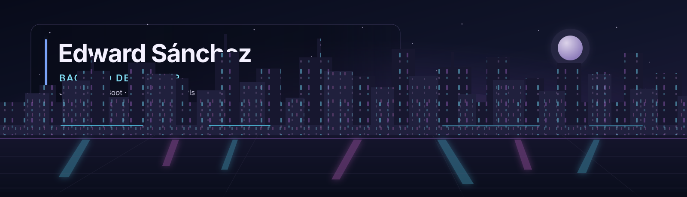

  

  

    <strong>Backend Developer · Java / Spring Boot · Python · REST APIs</strong> 
    Algorithms, web experiences &amp; mobile applications 
    Armenia, Colombia · Systems Engineering student at Universidad del Quindío
  

  
  
  
  
  
    
  

---

## 👨‍💻 About me

I enjoy understanding how things work under the hood—and turning that knowledge into useful software. My main focus is building reliable backends and APIs, while my projects also explore algorithm design, web interfaces, and Android development.

In 2024, I was part of Celuweb's web-scraping research group, where I built Python scrapers with Selenium, Scrapy, and Beautiful Soup. I'm open to backend and software engineering opportunities.

## 🏆 GitHub achievements

  

## 🛠️ Technologies &amp; tools

  <strong>Backend &amp; languages</strong> 
  
  
  
  
  
  
    

  <strong>Algorithms &amp; problem solving</strong> 
  
  
  
  
    

  <strong>Frontend &amp; mobile</strong> 
  
  
  
  
  
    

  <strong>Data &amp; delivery</strong> 
  
  
  
  
  
  

## 🚀 Featured work

### 📈 [Investment Algorithm](https://github.com/EddSanchezz/investment-algorithm)
An algorithmic financial-analysis system with data ingestion, asset comparison, pattern and volatility analysis, a Flask API, dashboards, and PDF reports.

- **Project scope:** 23 assets, 5+ years of historical prices, and 47 unit tests.
- **My contribution:** Improved DTW processing with a Sakoe–Chiba window and bounded correlation analysis to a 252-day window.
- **Stack:** Python · Flask · Docker

### 🧩 [PatternGuard](https://github.com/EddSanchezz/pattern_detector)
A full-stack pattern-validation app with a regular-expression engine built from scratch: tokenizer, parser, Thompson NFA construction, and execution—paired with a Flask API and React UI.

- **Stack:** Python · Flask · React · Vite · Tailwind CSS

### 🌐 [VitalTrack](https://github.com/EddSanchezz/VitalTrack)
A full-stack health and activity tracker with user and health-profile management, activity logs, wearable devices, and consolidated PDF reports.

- **Stack:** Angular · PrimeNG · TypeScript · Express · SQLite · Docker

### 📱 [ServiLocal](https://github.com/EddSanchezz/servi-local)
An Android app concept connecting people in Quindío with local services. I worked on authentication and session flows, profiles, notifications, and navigation/UI fixes.

- **Stack:** Kotlin · Jetpack Compose · Hilt
- **Status:** Uses in-memory demo data; remote persistence and backend integration are not yet implemented.

### 🔎 [Scientific Abstract Analyzer](https://github.com/EddSanchezz/comparador-textos-algoritmico) · *Team project*
Analyzes scientific abstracts from PDFs using classic and embedding-based similarity, hierarchical clustering, and exact string-search algorithms.

- **My contributions:** Embedding-based similarity measures and PDF extraction/refactoring.
- **Stack:** Python · Streamlit · NLP · Sentence Transformers

## 🤝 Collaboration

In [RickAndMortyApi](https://github.com/jeronimoguerreromaya/RickAndMortyApi), I contributed to a layered Android architecture with Hilt, domain models, mappers, and tests, and fixed rotation and empty-state issues.

## 📊 GitHub stats

  
  
   
  

## 📬 Let's connect

I'm always glad to talk about backend engineering, algorithms, or building useful products. Reach me at **[edwar5020@gmail.com](mailto:edwar5020@gmail.com)** or [connect on LinkedIn](https://linkedin.com/in/eddsanchezz).

  

